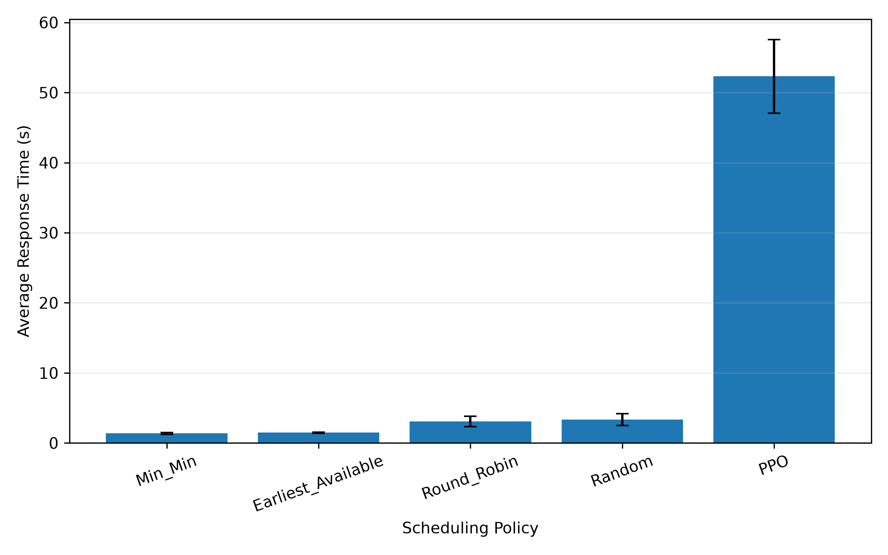
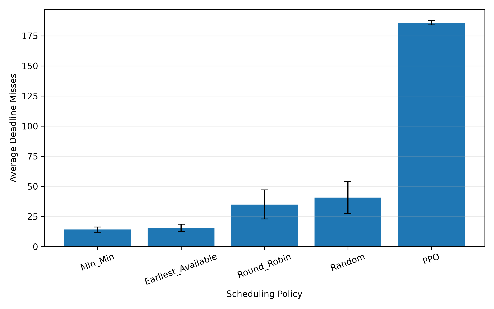
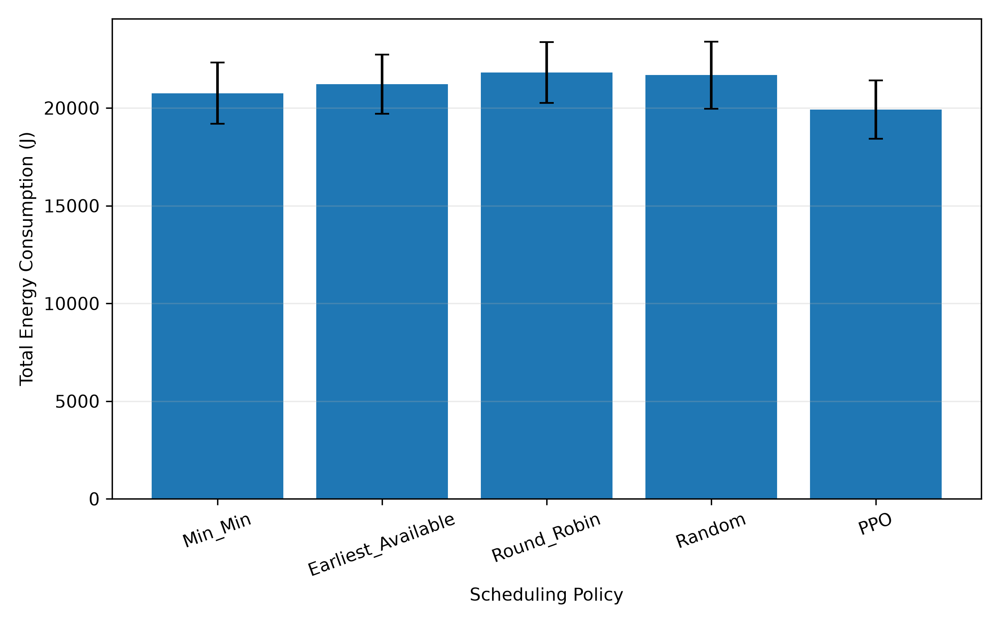

# 📡 Wireless Cloud DRL Research

<p align="center">
  <strong>Channel-Aware Deep Reinforcement Learning for Intelligent Task Scheduling in Wireless Cloud Computing Networks Using Adaptive Modulation and Channel Estimation</strong>
</p>

<p align="center">
  
  
  
  
</p>

## 👨‍💻 Researcher

**Kotha Konda Sai Teja**

This repository contains simulation code, experiment outputs, a trained model artifact, and figures for an M.Tech research project exploring the relationship between wireless-link reliability and cloud task scheduling.

## 🎯 Project Overview

Wireless cloud computing performance depends on both communication quality and cloud computing resources. This project studies a simulation framework that combines:

- 📶 **OFDM wireless communication** over a multipath Rayleigh fading channel with additive white Gaussian noise (AWGN).
- 📡 **Channel estimation** using Least Squares (LS) and Linear Minimum Mean Square Error (LMMSE) methods.
- 🔄 **Adaptive modulation** across BPSK, QPSK, 16-QAM, and 64-QAM.
- 📦 **Packet-level reliability analysis**, including packet error rate (PER) calibration.
- 🔁 **Retransmission modelling** with a maximum of four attempts.
- ☁️ **Cloud task scheduling** across heterogeneous virtual machines.
- 🤖 **Reinforcement learning**, with Proximal Policy Optimization (PPO) evaluated against heuristic scheduling baselines.

> The work is simulation-based. It is not a measurement campaign on a physical wireless testbed.

## 🧪 Experimental Setup

### 📶 Wireless link

| Parameter | Configuration |
|---|---:|
| OFDM subcarriers | 64 |
| Cyclic prefix | 16 samples |
| Pilot subcarriers | 16 |
| Data subcarriers | 48 |
| Channel model | 8-tap Rayleigh multipath |
| Noise | AWGN |
| Modulations | BPSK, QPSK, 16-QAM, 64-QAM |
| Packet size | 1500 bytes |
| Packet-calibration SNR values | 16, 20, 26, 30 dB |

### ☁️ Cloud environment

The simulated cloud environment uses five virtual machines with processing capacities of **1000, 1500, 2000, 2500, and 3000 MIPS**.

### 🤖 Scheduling policies

Five scheduling policies are compared:

1. Min-Min
2. Earliest Available
3. Round Robin
4. Random
5. PPO

The reported comparison uses **five random seeds** and **200 tasks per seed**.

## 📊 Main Scheduling Results

The table below reports the five-seed average results from `results/v3/v3_final_policy_summary.csv`.

| Scheduling policy | Average response time (s) | Average deadline misses | Total energy (J) |
|---|---:|---:|---:|
| **Min-Min** | **1.3717** | **14.2** | 20,757.7012 |
| Earliest Available | 1.4672 | 15.6 | 21,216.8840 |
| Round Robin | 3.0747 | 35.0 | 21,818.0587 |
| Random | 3.3365 | 40.8 | 21,682.2309 |
| PPO | 52.3104 | 185.8 | **19,909.9953** |

### 🔍 Interpretation

- 🥇 **Min-Min** achieved the lowest average response time and the fewest average deadline misses in this experiment.
- ⚡ **PPO** achieved the lowest reported energy consumption.
- ⚠️ PPO's response time and deadline-miss performance were substantially worse than the heuristic baselines. The current results therefore do **not** show that PPO is the best overall scheduler.
- A diagnostic run showed the PPO policy repeatedly selecting one VM action. Improving policy learning, exploration, and reward design remains future work.

## 📈 Publication Figures

### ⏱️ Average response time



### 📅 Deadline misses



### ⚡ Energy consumption



## 🗂️ Repository Structure

```text
Wireless-Cloud-DRL-Research/
├── graphs/
│   ├── ppo_training_stability/
│   └── v3/
│       └── publication/
├── models/
│   └── v3/
│       └── wireless_cloud_ppo_final.zip
├── python/
│   └── v3/
├── results/
│   └── v3/
├── .gitignore
└── README.md
```

The repository also includes earlier exploratory scripts, plots, and result files in addition to the V3 experiment files.

## 🚀 Getting Started

1. Clone the repository:

   ```bash
   git clone https://github.com/Saiteja8466/Wireless-Cloud-DRL-Research.git
   cd Wireless-Cloud-DRL-Research
   ```

2. Create and activate a Python virtual environment.
3. Install the packages required by the scripts you intend to run. A pinned dependency file and complete end-to-end run instructions are still to be added.
4. Inspect the V3 scripts in `python/v3/`, experiment outputs in `results/v3/`, and figures in `graphs/v3/publication/`.

> ℹ️ The saved PPO model is an experiment artifact. Reproducing its evaluation requires the matching environment implementation and compatible package versions.

## ⚠️ Assumptions and Limitations

- The reported results come from simulation, not a physical radio or cloud testbed.
- The retransmission model assumes independent transmission outcomes across attempts.
- Explicit ACK/NACK feedback delay and energy, and HARQ, are not modelled.
- The packetized workload uses conservative task-size limits derived from measured packet-error statistics.
- Five-seed standard deviations describe variation across those runs; they are not confidence intervals or statistical significance tests.
- PPO currently shows a policy-collapse issue in a diagnostic run and requires further improvement.

## 🔭 Future Work

- Improve PPO exploration, reward design, and state representation.
- Investigate why the current policy repeatedly selects one VM.
- Expand evaluation across more random seeds and workload conditions.
- Model acknowledgement/feedback overhead and more realistic retransmission behaviour.
- Improve reproducibility with pinned dependencies and end-to-end execution instructions.
- Validate the framework using a suitable network simulator or physical testbed.

## 📚 Research Status

This is an ongoing academic research project. The manuscript is under preparation; this repository does not indicate acceptance or peer review of a publication.

## 🤝 Contact

For research-related discussion, please use the GitHub repository's Issues section.

---

<p align="center">
  Built with 🐍 Python, 📡 wireless communication simulations, and 🤖 reinforcement learning.
</p>
